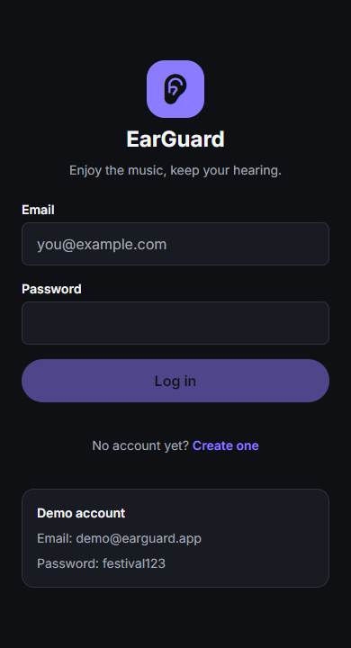
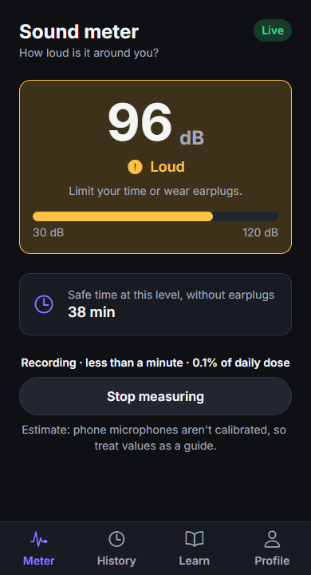
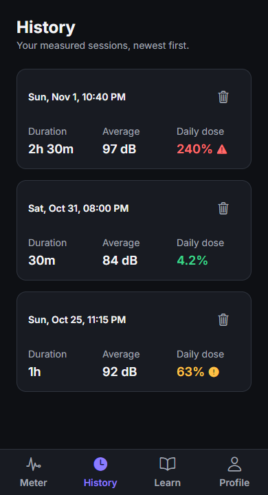

# EarGuard

Course project for Mobile Applications at UCLL (2026–2027). An app that helps prevent hearing damage at festivals: it measures how loud it is around you, tells you how long that level is safe, and keeps a history of your measurements.

This is the PWA version. A native version (Expo, iOS + Android) follows from the same codebase.

Live: https://earguard-phi.vercel.app

<p>
  
  
  
</p>

## Login

| Email | Password |
|---|---|
| `demo@earguard.app` | `festival123` |

You can also create your own account on the sign-up screen (no email verification).

## Target audience

People who go to festivals and concerts, mostly 16–35, who don't really know how loud it is or how long they can stay near the stage without earplugs.

## Features

- Sound meter using the phone's microphone, with a demo mode as fallback when the mic isn't available
- Safe listening time per level (NIOSH: 85 dB for 8 hours, halved every +3 dB)
- Measurements are saved as sessions (duration, average dB, % of daily dose) and shown on the History tab
- Hearing tips
- Login and sign-up with Supabase

## Competitors

- **NIOSH Sound Level Meter**: accurate, but iOS only and aimed at workplace measurements.
- **Decibel X** and other sound meter apps: show numbers, but no advice on what to do with them.
- **Apple Watch Noise app**: needs an Apple Watch.

EarGuard is aimed at festivals specifically: plain advice instead of just decibels, works on any phone through the browser, and keeps a history per account.

## Built with

Expo (SDK 52) / React Native Web, Expo Router, TypeScript, Zustand, Supabase, Cypress. Hosted on Vercel.

## Running it locally

```sh
npm ci
cp .env.example .env   # fill in your Supabase URL and publishable key
npm run web
```

For your own Supabase project: run the SQL in `supabase/migrations/` in the SQL Editor and turn off "Confirm email" under Authentication.

Tests:

```sh
npm run build:web
npm run serve:web     # separate terminal
npm run cypress:run
```

GitHub Actions runs the typecheck, build and Cypress tests on every push. Vercel deploys the `pwa` branch.

## Roadmap

PWA:
- [x] Login / sign-up
- [x] Live sound meter + demo mode
- [x] Safe time and dose per session
- [x] Session history
- [x] Installable, deployed on Vercel

Native app:
- [ ] Microphone on native (expo-audio)
- [ ] Measuring in the background
- [ ] Notifications to put in earplugs or take a break
- [ ] Total dose per day instead of per session
- [ ] Saving sessions offline and syncing later

## Notes

Phone microphones aren't calibrated, so the dB values are an estimate. In the PWA the meter only works while the app is open.
